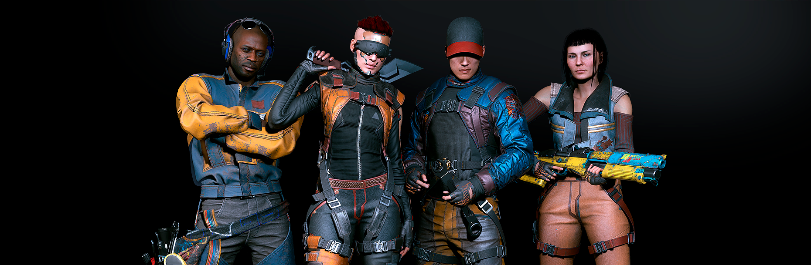
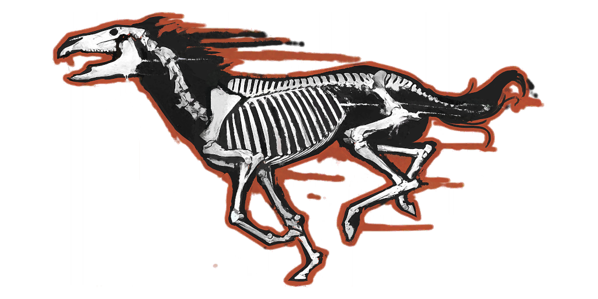

{width=1860px height=609px scale=1313px}

[image:./Aldecaldos-2.webp:::14.026602176541717,15.4776299879081,75.93712212817412,68.92382103990326:219px::512px:1024px:left]

### **Aldecaldos** - одна из крупнейших кочевых группировок. В отличие от банд Night City, Альдекальдо не делят территорию и не строят иерархию вокруг насилия: это сеть семей на колесах, где власть старейшины уравновешивается необходимостью кормить всех.

История клана начинается в Лос-Анджелесе 1990-х, когда Хуан Альдекальдо, потерявший сына в бандитской перестрелке, собрал вокруг себя людей, уставших от гангстерского насилия. Сначала это был отряд добровольцев, защищавший кварталы от банд; к моменту ухода из города в нём насчитывалось около пяти тысяч человек. Когда стало ясно, что полиция и власти не справляются, а противодействие только растёт, эти люди покинули Лос-Анджелес и стали первой настоящей кочевой семьёй. \
В 2000-х Альдекальдо пережили два перелома: контракт на расчистку радиоактивных руин Питтсбурга после аварии и смерть Хуана в Мексике, после которой клан возглавил Сантьяго. В 2015 году Альдекальдо вернулись в США - пограничники не смогли их остановить, потому что кочевников было слишком много, а государственных служащих слишком мало. После Четвёртой корпоративной войны клан помогал разбирать завалы и ставил временные лагеря у плотины Коронадо; со временем близость к Альдекальдо повлияла на южные районы Хейвуда, которые стали называться Санто-Доминго.

Экономика держится на трёх вещах: перевозках, сельском труде и мародёрстве. Кланы специализируются на спасении и восстановлении разрушенных городов, работают наёмными руками на фермах, занимаются бутлегерством и перевозкой краденого. Часть семей живёт исключительно контрабандой и доставкой «посылок» через границы свободных штатов. Из снаряжения кочевники предпочитают рефлекс-ускорители, машины с серьезным тюнингом и мотоциклы - техника должна выдерживать дорогу, а не выглядеть круто.

Идеология держится на двух вещах: взаимной ответственности и недоверии к корпорациям. После того как в 2023 году кочевников наняли разбирать радиоактивные завалы башни Arasaka и многие из них умерли от лучевой болезни, в клане закрепилось правило: никаких долгосрочных контрактов с мегакорпорациями, только разовые сделки. Именно поэтому попытки наладить постоянное сотрудничество с корпорациями вызывают в лагере глухое раздражение: часть семьи считает, что это путь к зависимости, а не к выживанию. \
\
В остальном Альдекальдо ценят индивидуальность и свободу выше всего: они носят кожанки, наколенники или защитные импланты, кепки дальнобойщиков, шьют на одежду нашивки в знак верности семье, клану или нации, но никогда не носят ничего похожего на униформу или «цвета» банды.

*«Тот, кто живёт в сердцах близких, не умрёт никогда»*

{width=1024px height=512px scale=1074px}

**Назначение:**

- Перевозка пассажиров и товаров через границы свободных штатов
- Работа наёмными руками на корпоративных фермах
- Бутлегерство, контрабанда и перевозка краденого
