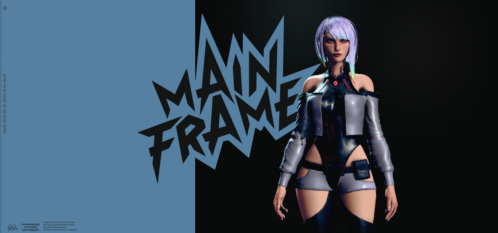
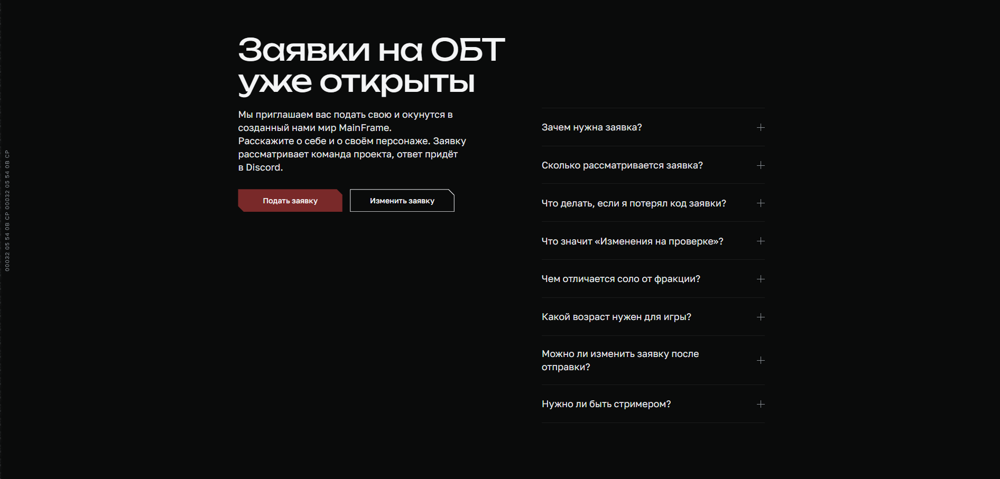
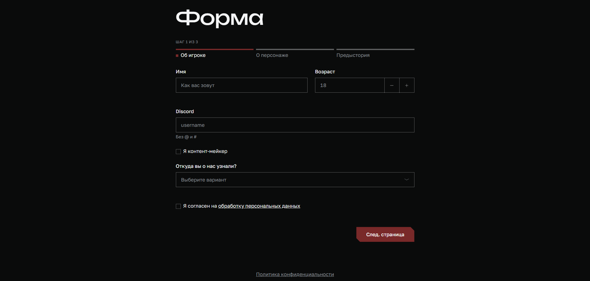
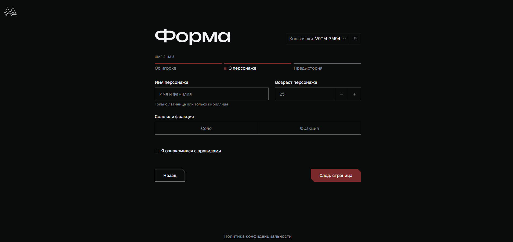
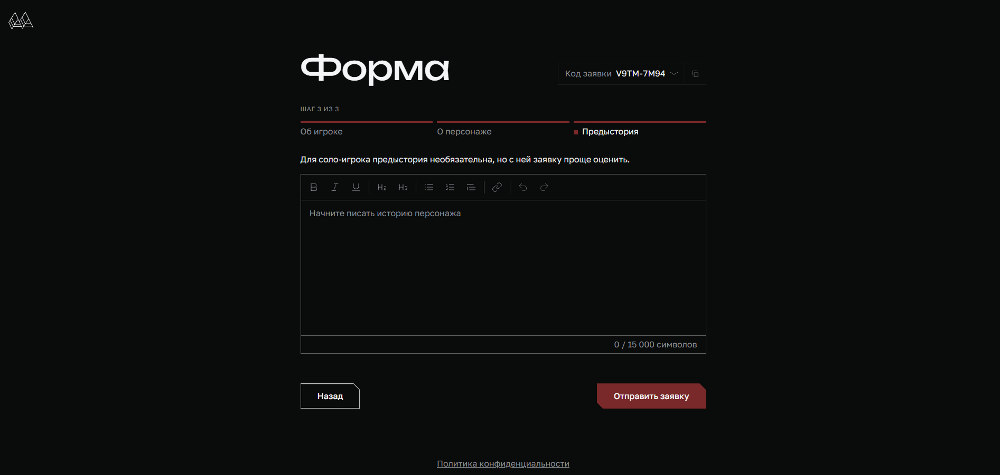
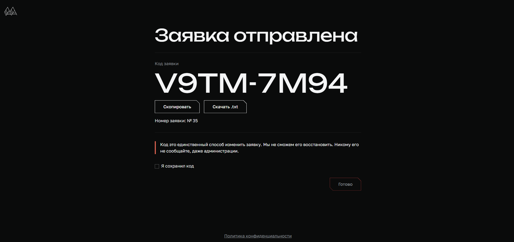

## Добро пожаловать на проект Mainframe!

Для того, чтобы начать игру Вам необходимо подать заявку с информацией о Вас и Вашем будущем персонаже. Для этого Вам необходимо выполнить следующие действия:

### 1\. Перейдите на [Сайт](https://landing.mainframenetwork.com/) и [Discord](https://discord.gg/mainframe) сервера

{width=1901px height=893px scale=671px}

### 2\. Ознакомьтесь с базовой информацией о Проекте

{width=1839px height=1070px scale=674px}

### 3\. Ознакомьтесь с [Правилами сервера](./rules/allrules.md)

### 4\. Перейдите к подаче заявки

{width=1892px height=907px scale=682px}

### 5\. Заполните информацию «**О себе»**

{width=1899px height=904px scale=686px}

### 6\. Заполните информацию «О персонаже»

{width=1910px height=904px scale=694px}

### 7\. При желании\\необходимости заполните предысторию персонажа.

{width=1893px height=901px scale=695px}

### 8\. Сохраните код заявки любым удобным для Вас методом.

{width=1913px height=903px scale=702px}

[highlight:red]**ВАЖНО!**[/highlight] **Никому не сообщайте код Вашей заявки, даже администрации сервера.**

### 9\. Ожидайте ответа на Вашу заявку [в канале Discord](https://discord.com/channels/391934604665159680/1561073199469437010)

### 10\. Все дальнейшие инструкции Вам объявит администратор в данном канале

## Желаем удачи и ждем Вас на нашем сервере!
